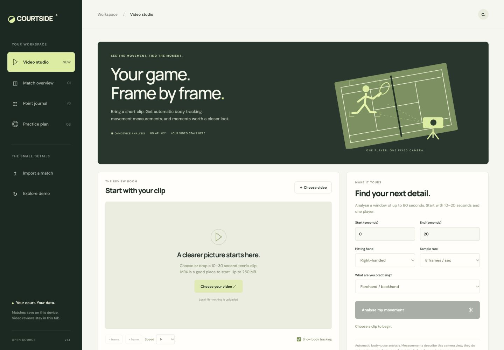

<div align="center">

# ◒ COURTSIDE

**Tennis, understood.**

Video review and match tracking. On your device.

**[Try the demo ↗](https://wuser-lab.github.io/courtside/)**

</div>



- **Review video** — body tracking, slow playback, and timestamped notes.
- **Track matches** — scoring, momentum, serve stats, and court maps.
- **Keep your data** — local processing, JSON/CSV exports, no API key.

Video measurements are experimental. Ball and racket tracking are not supported.

## Run

Node.js 20+. No install or build step.

```sh
git clone https://github.com/wuser-lab/courtside.git
cd courtside
npm start
```

Open [localhost:4173](http://127.0.0.1:4173). Run `npm test` for tests.

[Filming guide](docs/VIDEO.md) · [Details](docs/PROJECT.md) · [Contributing](CONTRIBUTING.md) · [MIT license](LICENSE)
