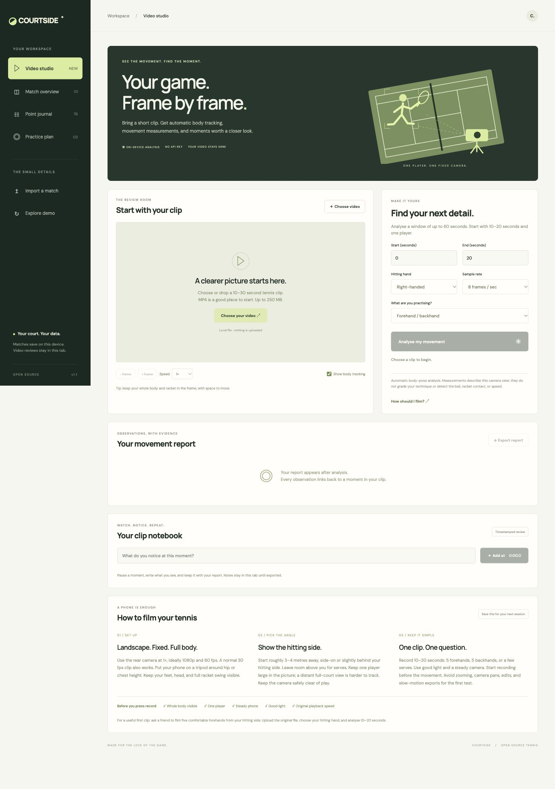
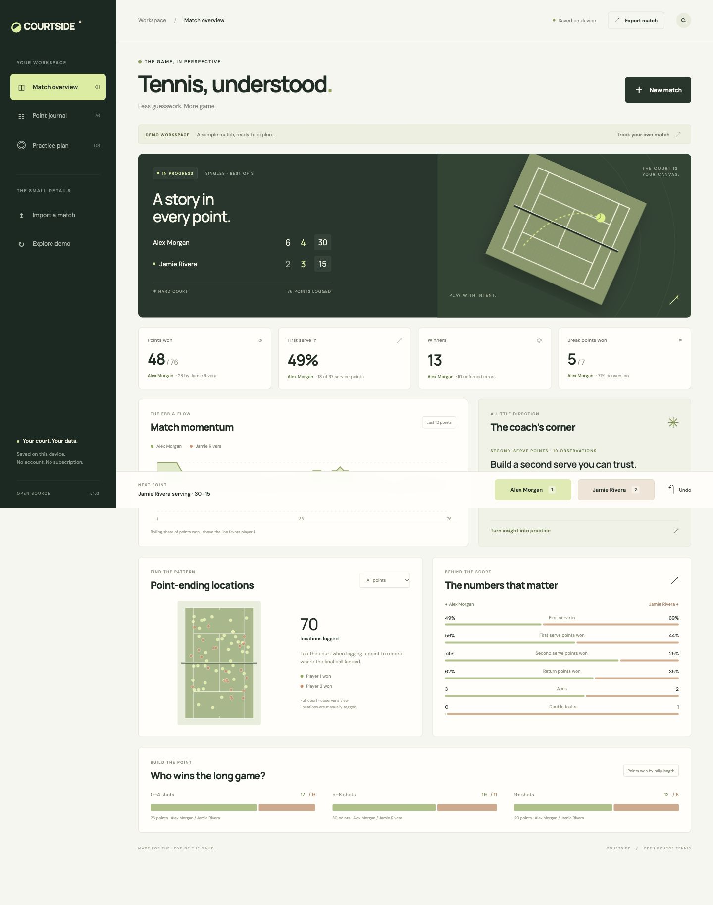

<div align="center">

# ◒ COURTSIDE

### Tennis, understood.

A beautiful, local-first tennis match and video studio for players and coaches.<br>
Track the point. Understand the pattern. Take it to practice.


[Try the live demo](https://wuser-lab.github.io/courtside/) · [Video guide](VIDEO.md) · [Get started](#run-locally) · [What it does](#built-for-the-changeover) · [How it works](METHODOLOGY.md) · [Contribute](../CONTRIBUTING.md)

</div>



## New: video movement analysis

Choose a clip and run **real on-device body-pose inference**. Review skeleton overlays, projected knee and elbow angles, a movement trace, and clickable evidence timestamps. Slow the video down, add timestamped notes, and export a JSON report. No API key or video upload is needed.

The MediaPipe runtime, WASM, and Lite model are bundled in the project. Analysis samples 4 or 8 frames per second over a window of up to 60 seconds. There is no installation or build step; the browser loads the model on demand.

This is experimental **movement review**, not an automated technique grade. It does not detect the ball, racket contact, shot quality, or speed. No-person footage produces an insufficient-detection message. See [how to film and what the measurements mean](VIDEO.md).



## Built for the changeover

The score tells you who is ahead. COURTSIDE helps you see how they got there.

Log points from the sideline, review service and return patterns, and give the next practice a purpose. All calculations use the same replayable point history, so undoing a point updates the score and every chart together.

| For players | For coaches | For developers |
| --- | --- | --- |
| Track a match without a subscription | Tag final-ball locations and rally length | Pure scoring engine, separate from the UI |
| See service and return patterns | Keep a coaching notebook | JSON archives and analysis-friendly CSV |
| Leave with focused practice ideas | Review momentum and break opportunities | No build step, vendored pose runtime, built-in Node tests |

- **Real scoring.** Advantage games, best of 3 or 5 sets, and a 7-point tiebreak at 6–6 in every set. Correct service rotation through tiebreaks.
- **Point-by-point capture.** Winner, serve, rally length, outcome, and optional court location. Use `1` / `2` to open the logger and `Z` to undo.
- **A living match overview.** Rolling momentum, service and return percentages, break-point conversion, rally groups, aces, and double faults.
- **A coach’s corner.** Transparent, rule-based observations with minimum sample sizes, linked to three practical drills. No LLM or API key required.
- **Your data travels.** Local autosave, importable JSON backups, CSV exports, and editable coaching notes.
- **A considered interface.** Forest green, tennis-ball lime, original SVG court art, responsive layouts, keyboard controls, and reduced-motion support.

## Run locally

Requires Node.js 20 or newer. No install or build step.

```sh
npm start
```

Open **http://127.0.0.1:4173**. The first visit opens Video studio. Choose a local clip to review, or open Match overview for a deterministic, fictional sample match. Choose **New match** there to track your own. Starting or importing a match asks before replacing the current one.

Or serve the `dist/` directory with any static HTTP server. JavaScript modules need HTTP; opening `index.html` directly from the filesystem will not work.

```sh
npm test      # scoring, analytics, validation, and replay tests
npm run check
```

## Put it on GitHub Pages

1. Upload this project to a GitHub repository.
2. Open **Settings → Pages → Source → GitHub Actions**.
3. Run **Deploy GitHub Pages** in the Actions tab, or push to `main`.

The included workflow tests the engine and publishes `dist/`. Relative asset URLs support repository subpaths. You can also deploy `dist/` to any static host.

## Use it courtside

1. Enter the two players, surface, match format, and first server.
2. Select the point winner, then record serve, outcome, and rally length.
3. Optionally tap the court to tag the final-ball location; keyboard users can focus the court and use Enter and arrow keys.
4. Review the overview or point journal. Undo immediately if you mis-tag a point.
5. Write your observations under Practice plan, then export JSON to keep a backup.

The logger automatically sets a double fault to a second serve and a rally length of 0, and an ace to 1. Impossible ace/double-fault winners are excluded from the menu.

## Honest about the data

Match analysis uses manually logged points; its court locations are tagged by an observer. Video studio separately detects body landmarks from actual decoded clip frames. There is no ball tracking, live tour feed, or automated scouting. Momentum is a rolling share of points won, **not win probability**. Practice suggestions are descriptive prompts, not personalized predictions.

The app supports singles with advantage scoring and a 7-point tiebreak in every set. Doubles, no-ad, retirement, short sets, match tiebreaks, and 10-point final-set tiebreaks are not currently supported. The scoring conventions are documented against the [ITF Rules of Tennis](https://itf.uberflip.com/i/623773-rules-of-tennis/8).

There is one active match per browser. Data is stored under `courtside.match.v1` in localStorage; it does not sync across devices or hosts. Export JSON before switching matches or clearing browser data. Browser storage may be unavailable in some private browsing contexts; the app reports write failures and lets you export a backup.

There is no application analytics or backend. Google Fonts is an optional external request; system sans-serif fonts are used if it is unavailable. Video analysis loads bundled model assets from the app origin on demand; video content stays on device. Video clips, reports, and notes stay in tab memory and need a separate report export before leaving. The app does not install an offline service worker.

## Small codebase. Clear boundaries.

```text
dist/
  index.html       accessible app structure and dialogs
  style.css        responsive visual system
  engine.js        scoring, replay, validation, analytics, demo fixture
  app.js           UI, storage, import/export, court maps
  video-studio.js  playback, sampling, overlays, reports, notes
  video-metrics.js pure projected-angle and summary calculations
  pose-worker.js   off-thread MediaPipe inference
  vendor/          pinned MediaPipe runtime, WASM, model, license
tests/
  engine.test.mjs  deterministic scoring and analytics tests
  video-metrics.test.mjs aspect ratio, visibility, sampling, summaries
docs/
  METHODOLOGY.md   match definitions, assumptions, and data format
  VIDEO.md         filming guide and video measurement limitations
  dashboard.jpg   real application screenshot
server.mjs        tiny local static server
```

Points are the source of truth. Score and statistics are reconstructed from the event history rather than saved as independent mutable counters. This makes imports reproducible and undo reliable.

## Next on court

Potential contributions: match libraries, player-selectable analysis, editable historical points, 10-point final-set tiebreaks, doubles, print reports, and an installable offline mode. These are ideas, not existing features. See [CONTRIBUTING.md](../CONTRIBUTING.md).

Application code is released under the [MIT license](../LICENSE). Vendored MediaPipe and model assets are Apache 2.0 licensed; see [third-party notices](../THIRD_PARTY_NOTICES.md). Built for the love of the game.
